# Descripción
Aplicación web para el club y tienda de juegos de mesa El Rincón de Hermes, desarrollada a partir de los wireframes y el mockup diseñados en Figma en trabajos prácticos anteriores.

El proyecto fue refactorizado de páginas HTML independientes a una estructura basada en PHP, incorporando plantillas reutilizables mediante header.php, nav.php y footer.php, navegación dinámica y configuración mediante variables de entorno.

## Enlaces
Repositorio: https://github.com/Florare83/ERDH
Wireframes y Mockups en Figma: https://www.figma.com/design/hipG4LOssrktKAuL9P4VDI/ERDH?node-id=16-458&t=eVWlSxP531yBRfNM-1

## Tecnologías utilizadas
- HTML5 — estructura semántica de las vistas.
- CSS3 — estilos personalizados mediante estilos css.
- Bootstrap 5.3 — sistema de grillas, navegación y componentes.
- JavaScript — funcionalidades e interacción del sitio.
- PHP 8.x — refactorización de las páginas y generación de contenido dinámico.
- XAMPP — servidor local utilizado para ejecutar Apache y PHP.
- Prettier — formateo automático del código.
- Lighthouse (Chrome DevTools) — auditoría de accesibilidad.

## Refactorización a PHP
Durante la refactorización se reemplazaron las páginas HTML por archivos PHP.
Se implementó una estructura modular mediante plantillas reutilizables:
includes/
├── header.php
├── nav.php
└── footer.php
Las páginas principales reutilizan estas plantillas mediante require_once, evitando repetir el código del encabezado, menú de navegación y pie de página.
También se implementó navegación dinámica mediante la variable $pagina_actual, que permite determinar qué sección del menú debe mostrarse como activa.
Además, el título de cada página se establece mediante la variable $titulo_pagina.

## Variables de entorno
El proyecto utiliza un archivo .env para almacenar valores de configuración.
Las variables utilizadas son:
APP_NAME="El Rincón de Hermes"
APP_EMAIL="email@ejemplo.com"
APP_ENV=local
El archivo .env no se incluye en el repositorio y está excluido mediante .gitignore.
Para indicar las variables necesarias para ejecutar el proyecto se incluye el archivo:
.env.example
La configuración es cargada desde:
config/
└── env.php
La carpeta node_modules/ no se incluye en el repositorio porque sus dependencias pueden instalarse nuevamente mediante npm.

## Instalación y ejecución local
1. Clonar el repositorio
git clone https://github.com/Florare83/ERDH.git
2. Colocar el proyecto en XAMPP
Copiar o clonar el proyecto dentro de la carpeta:
C:\xampp\htdocs\
3. Crear archivo .env
Copiar .env.example y crear un archivo .env
Configurar las variables correspondientes:
APP_NAME="El Rincón de Hermes"
APP_EMAIL="email@ejemplo.com"
APP_ENV=local
4. Iniciar XAMPP
Abrir el panel de XAMPP e iniciar:
Apache
5. Abrir el proyecto
Ingresar desde el navegador a:
http://localhost/ERDH/clase5/index.php

## Servidor local ejecutándose
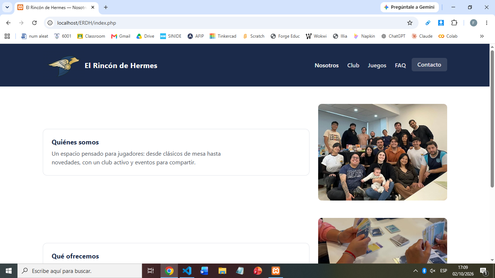

## Estructura Modular (SSI):
Utilización de las plantillas PHP reutilizables:
header.php
nav.php
footer.php
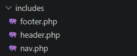

## Navegación dinámica
Las páginas utilizan un título dinámico mediante $titulo_pagina y determinan la sección activa del menú mediante $pagina_actual.
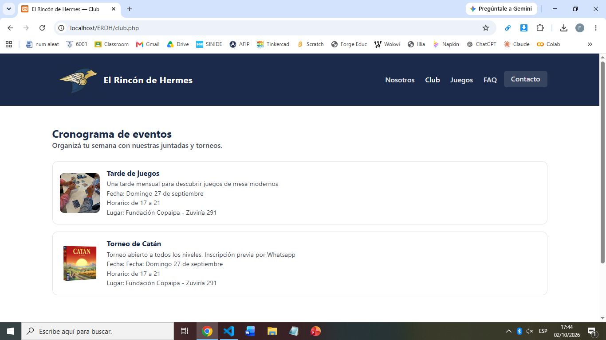
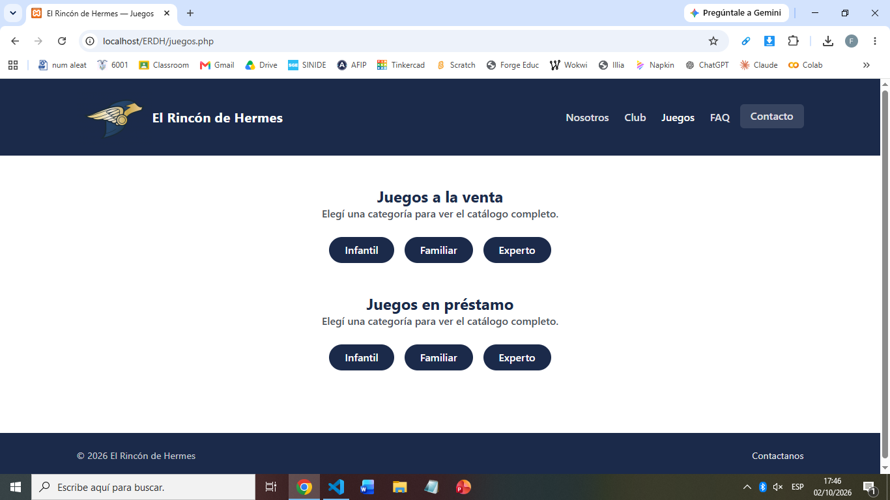

## Configuración de variables de entorno
El archivo .env.example contiene las variables necesarias para la configuración del proyecto.
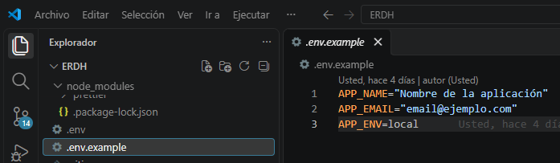

## Resultado de la prueba de accesibilidad
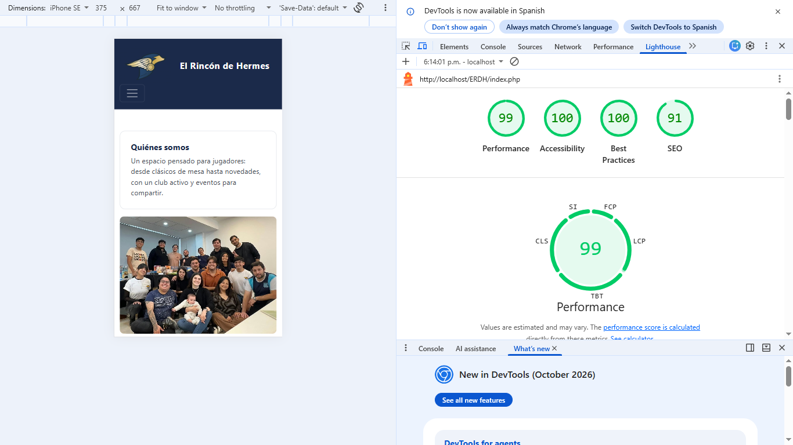

## Estructura
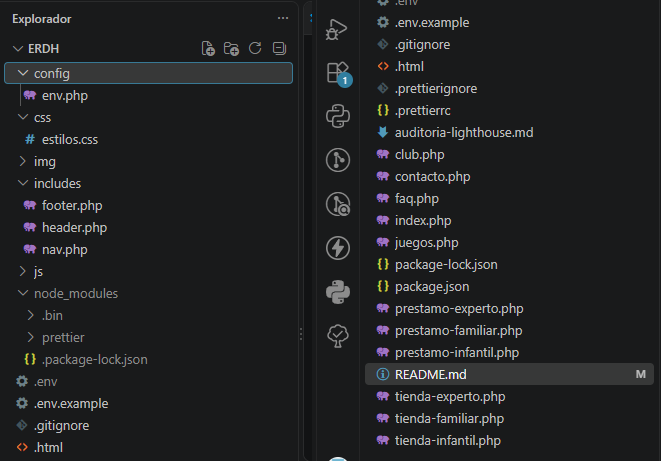

## Clase 5 – Procesamiento de Formularios y Seguridad Web

### Formulario POST – Contacto (`contacto.php`)
Formulario con nombre, correo y mensaje. Valida en servidor que los campos
no estén vacíos y que el correo tenga formato válido. Sanitiza con
`trim()` y `htmlspecialchars()`. Ante errores conserva los datos ingresados.

### Formulario GET – Buscador (`buscar.php`)
Módulo de búsqueda que recibe el término por `$_GET['q']`, lo sanitiza,
valida que no esté vacío y muestra los resultados coincidentes.

### Seguridad
Todas las variables de `$_POST` y `$_GET` se sanitizan con la función
`limpiar()` (`includes/funciones.php`) para prevenir XSS.

### Capturas

**1. Contacto vacío: errores de validación**

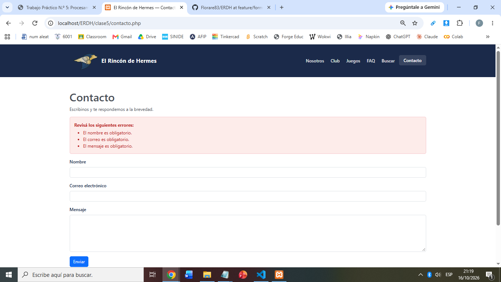

**2. Correo inválido: error de formato y campos conservados**

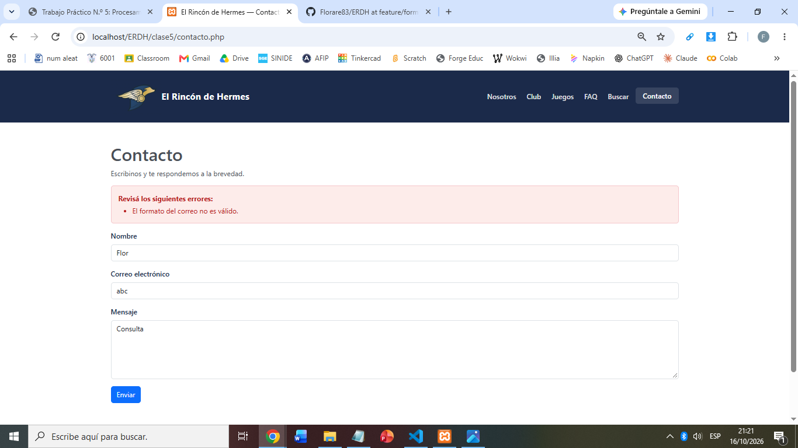

**3. Envío correcto**

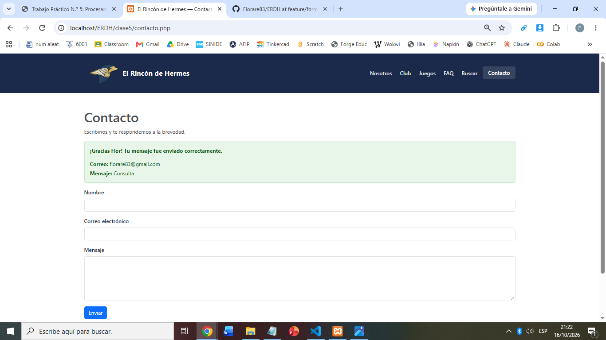

**4. XSS en contacto**

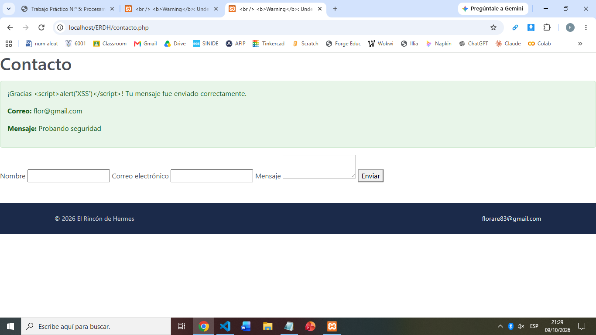

**5. Búsqueda por GET**

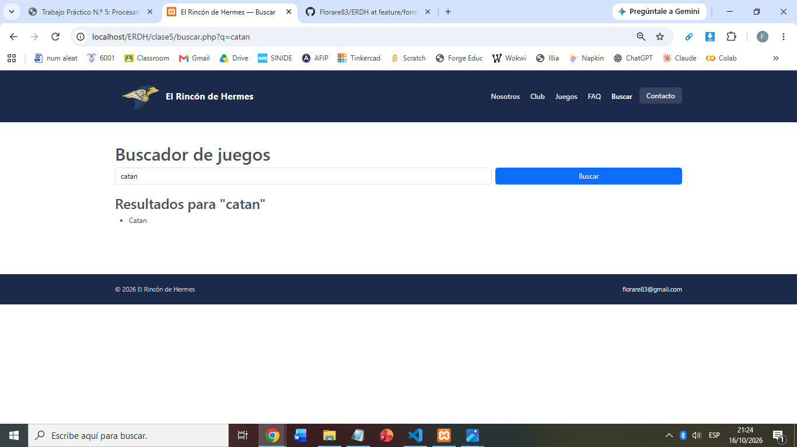

**6. Búsqueda vacía**

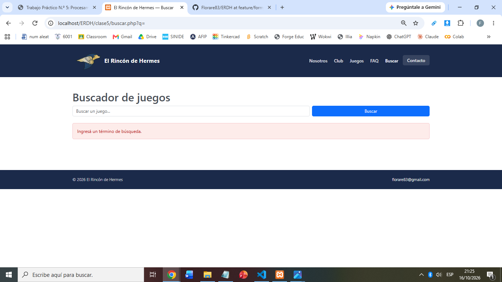

**7. XSS en el buscador**

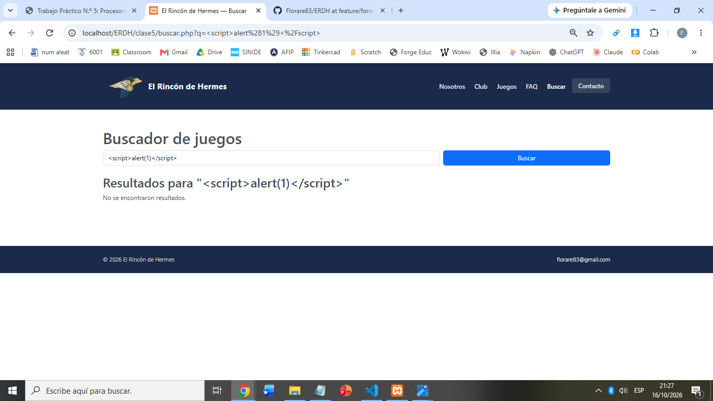

## TP6 – Diseño y Creación del Esquema Relacional en MySQL

Diseño de la base de datos del proyecto **El Rincón de Hermes**, aplicando normalización (1FN, 2FN y 3FN), script de creación en MySQL y consultas CRUD de prueba.

### Archivos

Carpeta [`clase6/`](clase6/):

- [`NORMALIZACION.md`](clase6/NORMALIZACION.md): registro sin normalizar, proceso de 1FN, 2FN y 3FN, y listado de tablas con PK y FK.
- [`schema.sql`](clase6/schema.sql): creación de la base `rincon_de_hermes`, las tablas, las claves foráneas y los índices.
- [`consultas.sql`](clase6/consultas.sql): sentencias `INSERT`, `SELECT`, `UPDATE` y `DELETE` para probar la estructura con datos del proyecto.

### Tablas del esquema

| Tabla | Descripción |
|---|---|
| `roles` | Roles de usuario (admin, socio) |
| `usuarios` | Datos personales, email, contraseña y rol |
| `categorias` | Infantil, Familiar y Experto |
| `editoriales` | Devir, Maldon, Multiverso, etc. |
| `estados_prestamo` | Pendiente, En curso y Devuelto |
| `juegos` | Catálogo de juegos, a la venta y en préstamo |
| `prestamos` | Juegos prestados a cada socio |
| `eventos` | Cronograma del club |
| `inscripciones` | Relación N:M entre usuarios y eventos |
| `mensajes_contacto` | Mensajes enviados desde `contacto.php` |

### Diagrama de relaciones

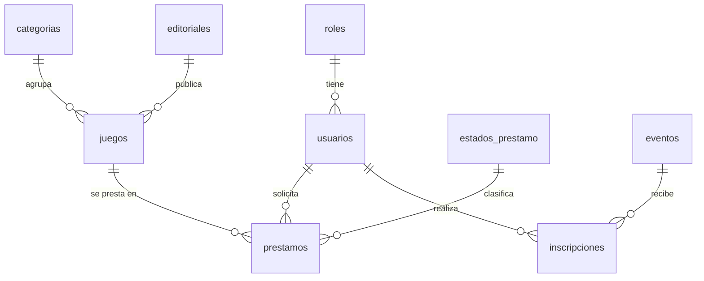

### Decisiones de diseño

- Las páginas de tienda y de préstamo muestran los mismos juegos, por eso hay una sola tabla `juegos` con los campos `disponible_venta` y `disponible_prestamo`.
- Jugadores y duración se guardan en columnas numéricas (mínimo y máximo) para poder filtrar.
- Los precios usan `DECIMAL(10,2)` y las contraseñas se guardarán como hash con `password_hash()` de PHP.
- Todas las claves foráneas usan el motor InnoDB para garantizar la integridad referencial.
- Se crearon índices sobre la categoría y el título del juego (usados por las páginas de catálogo y por `buscar.php`), el estado de los préstamos y la fecha de los eventos.

### Cómo ejecutarlo en local (XAMPP)

1. Iniciar **Apache** y **MySQL** desde el panel de XAMPP.
2. Abrir `http://localhost/phpmyadmin`.
3. En la pestaña **Importar**, cargar `clase6/schema.sql` (crea la base y las tablas).
4. Seleccionar la base `rincon_de_hermes`, ir a **Importar** y cargar `clase6/consultas.sql`.

Para volver a ejecutar las pruebas desde cero, importar de nuevo `schema.sql` (borra y recrea las tablas) y después `consultas.sql`.

### Consultas de prueba (CRUD)

- **Create:** datos iniciales en roles, categorías, editoriales, estados, usuarios, juegos, eventos y préstamos.
- **Read:** `SELECT` con `WHERE` y `ORDER BY`, y `INNER JOIN` entre juegos, editoriales y categorías, y entre préstamos, usuarios, juegos y estados.
- **Update:** cambio de precio de un juego y cierre de un préstamo, ambos con `WHERE`.
- **Delete:** baja de un mensaje de prueba con `WHERE`.


## Clase 7 – Persistencia y Conexión PHP-MySQL Segura (TP7)

Módulo de administración (CRUD) del catálogo de **juegos** de El Rincón de Hermes, conectado a MySQL mediante **PDO** e integrado al layout del sitio (Bootstrap + `header.php`, `nav.php`, `footer.php`).

La entidad gestionada es la tabla `juegos` del modelo diseñado en el TP6 (`clase6/schema.sql`), relacionada con `editoriales` y `categorias`.

### Estructura del módulo

```
clase7/
├── config/
│   ├── env.php              # Carga de variables de entorno (.env)
│   └── conexion.php         # Conexión PDO con try-catch (PDOException)
├── includes/
│   ├── header.php           # Plantilla modular (SSI)
│   ├── nav.php
│   ├── footer.php
│   └── funciones.php        # limpiar() y e() (escape de salida)
├── admin/
│   ├── index.php            # Listado (Read)
│   ├── crear.php            # Formulario + inserción (Create)
│   ├── editar.php           # Formulario + actualización (Update)
│   ├── eliminar.php         # Eliminación (Delete)
│   ├── _form.php            # Formulario compartido por crear/editar
│   └── _funciones_juegos.php# Captura y validación de datos
├── css/  img/  js/
└── .env.example
```

### Requisitos

- XAMPP (Apache + MySQL) o Laragon
- PHP 8.x
- Base de datos `rincon_de_hermes` importada desde `clase6/schema.sql`

### Instalación y ejecución local

1. Clonar o copiar el repositorio dentro de `C:\xampp\htdocs\`.
2. Iniciar **Apache** y **MySQL** desde el panel de XAMPP.
3. Abrir `http://localhost/phpmyadmin`, ir a **Importar** y cargar `clase6/schema.sql`.
4. Cargar los datos iniciales ejecutando en la pestaña **SQL** la sección `1) CREATE - Datos iniciales` de `clase6/consultas.sql`.
5. Copiar `clase7/.env.example` como `clase7/.env` y completar las variables:

```
APP_NAME="El Rincón de Hermes"
APP_EMAIL="email@ejemplo.com"
APP_ENV=local
DB_HOST=localhost
DB_NAME=rincon_de_hermes
DB_USER=root
DB_PASS=
```

6. Abrir en el navegador:

```
http://localhost/ERDH/clase7/admin/index.php
```

> El archivo `.env` no se incluye en el repositorio (está en `.gitignore`). Las credenciales de la base de datos se leen únicamente desde ese archivo.

### Funcionalidades del CRUD

| Operación | Archivo | Descripción |
|---|---|---|
| **Read** | `admin/index.php` | Lista los juegos con su editorial y categoría (`INNER JOIN`), ordenados del más reciente al más antiguo. |
| **Create** | `admin/crear.php` | Formulario con selects de editorial y categoría cargados desde la BD. Valida en el servidor y guarda con `INSERT`. |
| **Update** | `admin/editar.php` | Carga el registro por `id`, lo muestra en el formulario y lo actualiza con `UPDATE ... WHERE id_juego = :id`. |
| **Delete** | `admin/eliminar.php` | Elimina por `id` con `DELETE ... WHERE id_juego = :id`, previa confirmación en el navegador. |

Después de cada operación se redirige al listado con un mensaje de estado (`?status=created|updated|deleted|...`) que se traduce a un texto fijo del servidor; nunca se imprime directamente el valor recibido por URL.

### Validaciones del servidor

- El título es obligatorio y no puede superar los 100 caracteres.
- Editorial y categoría deben estar seleccionadas.
- La cantidad máxima de jugadores no puede ser menor que la mínima.
- La duración máxima no puede ser menor que la mínima.
- El precio y el stock no pueden ser negativos.
- Ante errores, el formulario conserva los datos ingresados y muestra la lista de problemas.

### Seguridad

**Conexión segura (`config/conexion.php`)**
- Instancia de PDO con `ERRMODE_EXCEPTION`, `FETCH_ASSOC` y `EMULATE_PREPARES = false` (preparación real en el servidor).
- Bloque `try-catch` con `PDOException`. El detalle técnico del error solo se muestra si `APP_ENV=local`.
- Credenciales almacenadas en `.env`, fuera del repositorio.

**Consultas preparadas (Prepared Statements)**
- Todas las consultas (lectura, inserción, actualización y borrado) usan `prepare()` + `execute()` con parámetros nombrados (`:titulo`, `:precio`, `:id`, etc.).
- Ningún dato recibido por `$_POST` o `$_GET` se concatena dentro de una sentencia SQL.

Ejemplo (`crear.php`):

```php
$sql = "INSERT INTO juegos (titulo, id_editorial, ..., imagen)
        VALUES (:titulo, :id_editorial, ..., :imagen)";
$stmt = $pdo->prepare($sql);
$stmt->execute([':titulo' => $juego['titulo'], ...]);
```

**Prevención de XSS**
- Todas las variables impresas en las vistas pasan por `htmlspecialchars()` mediante el helper `e()` (`ENT_QUOTES`, `UTF-8`).
- Los datos se guardan "crudos" (solo `trim()`) y se escapan al momento de mostrarlos, para evitar el doble escapado en la base de datos.

**Otras decisiones de seguridad**
- El borrado se realiza mediante **POST** (no por un enlace GET), para que no pueda dispararse por error o desde un enlace externo.
- Los identificadores recibidos se validan con `filter_input(..., FILTER_VALIDATE_INT)`.
- Si se intenta eliminar un juego con préstamos asociados, la violación de clave foránea (SQLSTATE `23000`) se captura y se informa al usuario con un mensaje claro, sin errores sin controlar.


## TP8 — Manejo de estado, sesiones y autenticación (`clase8/`)

Módulo de registro, inicio y cierre de sesión en PHP + MySQL (PDO), con control de acceso por roles (`admin` / `usuario`), integrado en la aplicación principal.

### Archivos principales
| Archivo | Función |
|---|---|
| `registro.php` | Alta de usuarios con sanitización, email único y `password_hash` |
| `login.php` | Verificación con `password_verify` y creación de la sesión |
| `logout.php` | Cierre de sesión: vacía `$_SESSION`, borra la cookie y destruye la sesión |
| `includes/sesion.php` | Inicio de sesión con cookie segura (HttpOnly, SameSite) |
| `includes/auth_guard.php` | Guardián de rutas y control por rol |
| `dashboard.php` | Vista protegida (cualquier usuario autenticado) |
| `admin/admin_panel.php` | Vista protegida solo para `admin` |
| `admin/*` | CRUD de juegos, ahora restringido al rol `admin` |
| `sql/01_tabla_usuarios.sql` | Script de la tabla `usuarios` |

### Base de datos
Tabla `usuarios`: `id`, `nombre`, `email` (UNIQUE), `password` (VARCHAR 255, guarda el hash), `rol` (VARCHAR: `admin` / `usuario`), `created_at`.

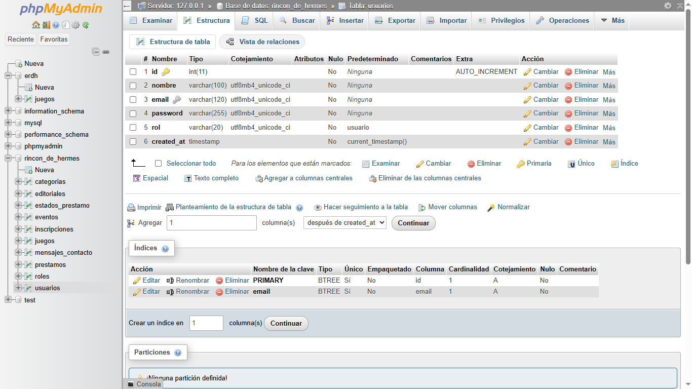

### Registro
Sanitiza con `htmlspecialchars`, valida en el servidor, comprueba que el email no exista y guarda el hash con `password_hash($password, PASSWORD_BCRYPT)` mediante consultas preparadas.

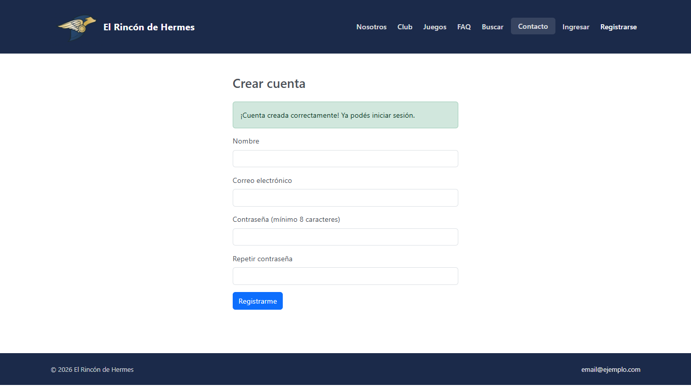
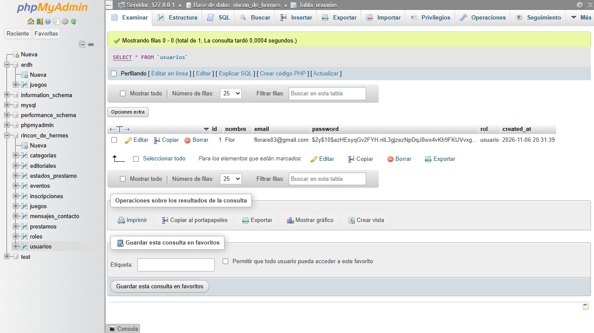

### Login y sesión
Compara con `password_verify()`. Si es correcto, ejecuta `session_regenerate_id(true)` (contra Session Fixation) y guarda `usuario_id`, `usuario_nombre` y `rol` en `$_SESSION`. La cookie de sesión es `HttpOnly` y `SameSite=Lax`.

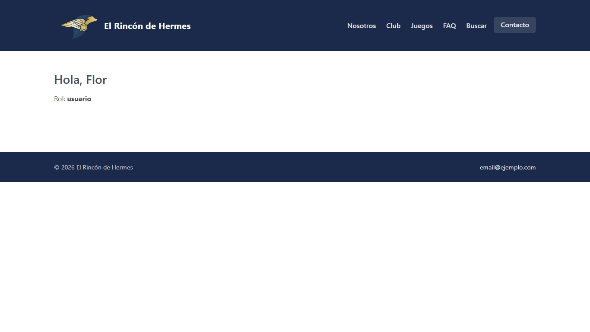
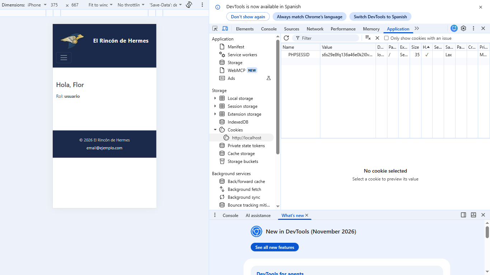

### Protección de rutas y roles
`auth_guard.php` redirige a `login.php?error=acceso_denegado` si no hay sesión. La función `requerir_rol('admin')` restringe `admin_panel.php` y el CRUD de juegos.

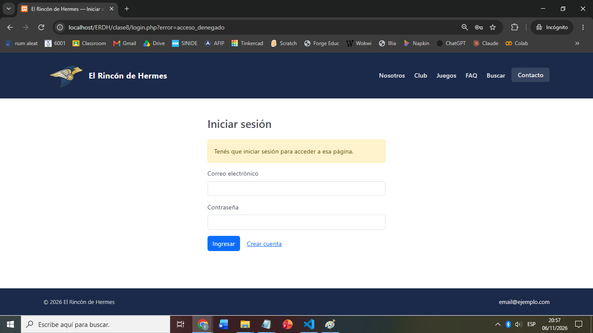
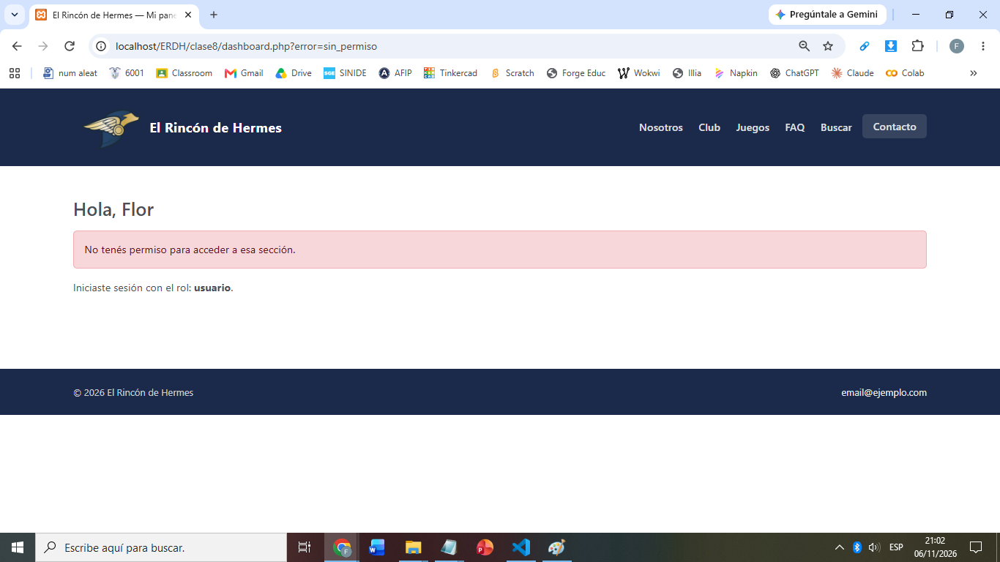

### Cierre de sesión
`logout.php` vacía `$_SESSION`, elimina la cookie de sesión del navegador, ejecuta `session_destroy()` y redirige al login. El botón "Salir" es un formulario POST.

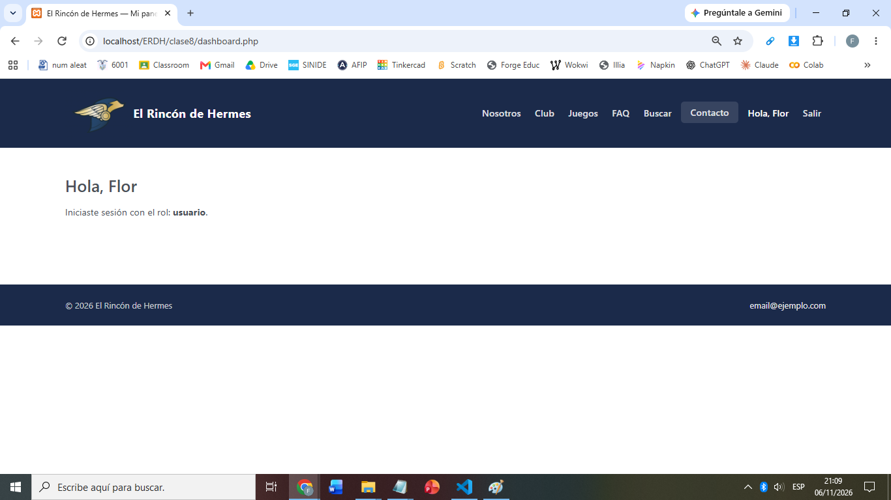
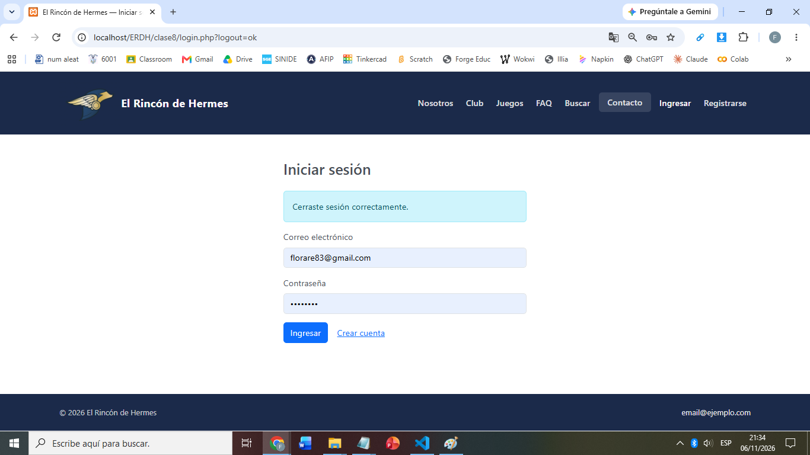

### Cómo ejecutarlo
1. Importar `clase6/schema.sql` en phpMyAdmin y luego `clase8/sql/01_tabla_usuarios.sql`.
2. Copiar `clase8/.env.example` a `clase8/.env` y completar las variables.
3. Abrir `http://localhost/ERDH/clase8/registro.php`.
4. Para crear un administrador: `UPDATE usuarios SET rol = 'admin' WHERE email = 'tu_email';`

## TP9 — Comunicación asincrónica y APIs (AJAX & JSON) (`clase9/`)

Se convirtió el buscador de juegos (`buscar.php`) en una búsqueda en tiempo real: el navegador consulta a un endpoint PHP mediante **Fetch API**, recibe la respuesta en formato **JSON** y actualiza solo la sección de resultados, sin recargar la página. Antes, el buscador filtraba un arreglo fijo de nombres; ahora consulta la tabla `juegos` de MySQL.

### Archivos principales

```
clase9/
├── api/
│   └── buscar_juegos.php   # Endpoint: consulta MySQL y responde JSON
├── buscar.php              # Vista: formulario + contenedor de resultados
└── js/
    └── main.js             # Fetch API, manejo de errores y renderizado del DOM
```

El resto del proyecto es el de `clase8/` (sesiones, roles y CRUD) sin cambios.

### Endpoint (`api/buscar_juegos.php`)

- Método: `GET`.
- Parámetro: `q` (opcional). Si no se envía, devuelve los primeros 20 juegos ordenados por título.
- Encabezado de respuesta: `Content-Type: application/json; charset=utf-8`.
- Consulta con `JOIN` a `editoriales` y `categorias`, usando `prepare()` + `bindValue()` con parámetro nombrado `:q`. Ningún dato del usuario se concatena en el SQL.
- Se escapan `%` y `_` del término (`addcslashes`) para que el usuario no pueda usarlos como comodines del `LIKE`.
- `display_errors` se desactiva dentro del endpoint para que un aviso de PHP no se mezcle con el JSON.
- Si la consulta falla, el detalle técnico se guarda con `error_log()` y al cliente solo se le informa un mensaje genérico.

**Códigos de estado HTTP**

| Código | Cuándo se devuelve |
|---|---|
| `200 OK` | Consulta exitosa. Si no hay coincidencias, `data` es un arreglo vacío |
| `400 Bad Request` | `q` no es texto, tiene 1 solo carácter o supera los 50 caracteres |
| `405 Method Not Allowed` | Se usa un método distinto de `GET` (incluye el encabezado `Allow: GET`) |
| `500 Internal Server Error` | Falla la consulta a la base de datos (`PDOException`) |

**Ejemplo de respuesta exitosa** (`GET api/buscar_juegos.php?q=cat`):

```json
{
    "status": "success",
    "total": 1,
    "data": [
        {
            "id_juego": 5,
            "titulo": "Catan",
            "editorial": "Devir",
            "categoria": "Familiar",
            "jugadores_min": 2,
            "jugadores_max": 6,
            "duracion_min": 60,
            "duracion_max": 120,
            "edad_minima": 12,
            "precio": 67888,
            "imagen": "img/catan.webp"
        }
    ]
}
```

**Ejemplo de respuesta de error** (`?q=a`, estado 400):

```json
{
    "status": "error",
    "message": "La búsqueda debe tener al menos 2 caracteres."
}
```

### Consumo desde el frontend (`js/main.js`)

- **Eventos capturados:**
  - `input` sobre el campo de búsqueda, con *debounce* de 300 ms para no enviar una petición por cada tecla.
  - `submit` del formulario, con `e.preventDefault()` para evitar la recarga de la página.
- **Petición:** `fetch()` con `async/await` y `encodeURIComponent()` para el término.
- **`AbortController`:** cancela la petición anterior cuando el usuario sigue escribiendo, evitando que una respuesta lenta y vieja pise a una más reciente.
- **Manejo de errores:** bloque `try...catch` y verificación de `response.ok`. Se lee el JSON también en las respuestas 400/500 para mostrar el mensaje que envía el servidor. Un error de red (`TypeError`) muestra "No hay conexión con el servidor".
- **Validación previa:** con un solo carácter no se consulta al servidor; se muestra "Escribí al menos 2 caracteres.".
- **Carga inicial:** al abrir `buscar.php` se ejecuta `buscar('')` y se muestran los juegos sin que el usuario haga nada.

### Manipulación dinámica del DOM

La respuesta `res.data` se recorre con `forEach` y por cada juego se construye una tarjeta `.game-card` (la misma de las páginas de tienda), con imagen, título, editorial, jugadores, duración, edad y precio. Solo se reemplaza el contenido del contenedor `#resultados`; el resto de la página no se recarga.

El estado de la búsqueda ("Buscando…", "N juego(s) encontrado(s).", errores) se informa en un párrafo con `role="status"` y `aria-live="polite"`, para que los lectores de pantalla anuncien los cambios.

### Seguridad

- **Consultas preparadas** en el endpoint (sin concatenar entradas del usuario).
- **Validación en el servidor** del parámetro `q` (tipo, longitud mínima y máxima), sin depender de la validación del cliente.
- **Prevención de XSS:** las tarjetas se arman con `createElement` y `textContent` en lugar de `innerHTML`. Si un título contuviera HTML o `<script>`, se mostraría como texto y no se ejecutaría. Por eso el endpoint no aplica `htmlspecialchars()`: el escape se realiza al momento de mostrar los datos, evitando duplicarlo.
- **Errores controlados:** el detalle técnico de una falla de base de datos no se expone al navegador.

### Capturas

**1. Endpoint: respuesta `200 OK` con el listado de juegos en JSON**

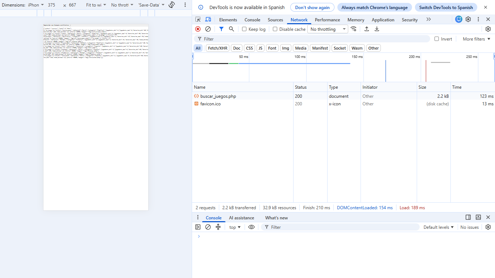

**2. Endpoint: `400 Bad Request` ante un término de un solo carácter (`?q=a`)**

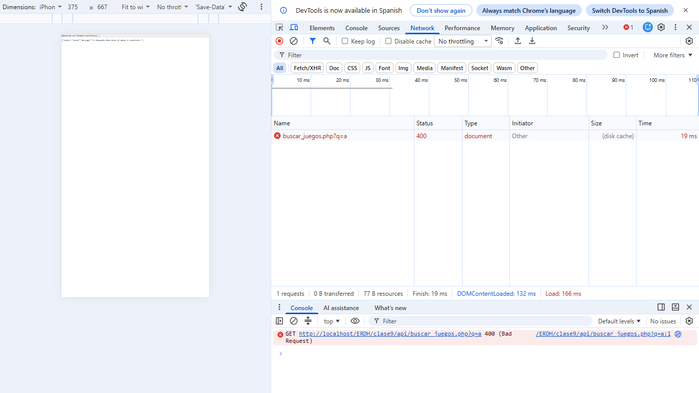

**3. Endpoint: `405 Method Not Allowed` al llamarlo con `POST` desde la consola**

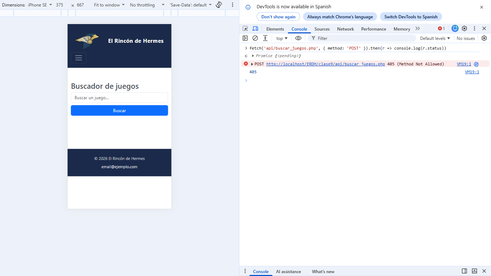

**4. Buscador: resultados filtrados en pantalla al escribir `cat`**

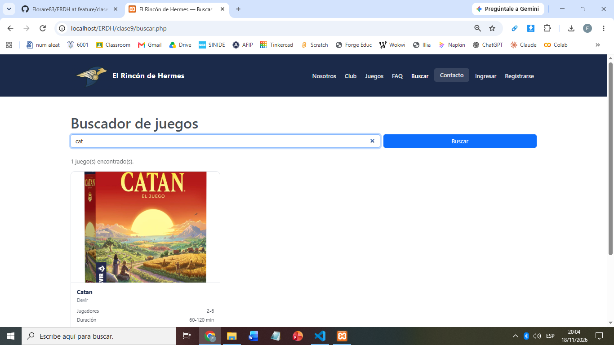

**5. Pestaña Network (Fetch/XHR): peticiones asincrónicas sin recarga de la página**

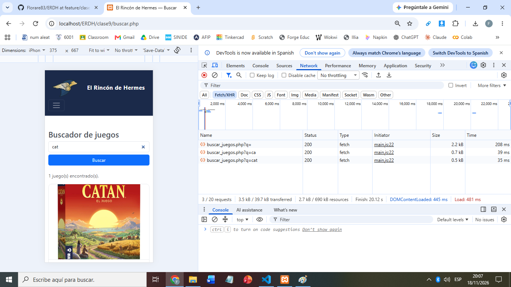

### Cómo ejecutarlo

1. Tener la base de datos creada con `clase6/schema.sql` y los datos de `clase6/consultas.sql` (el endpoint consulta la tabla `juegos`).
2. Copiar `clase9/.env.example` a `clase9/.env` y completar las variables, incluidas las de la base de datos (`DB_HOST`, `DB_NAME`, `DB_USER`, `DB_PASS`).
3. Iniciar Apache y MySQL desde XAMPP.
4. Abrir el buscador: `http://localhost/ERDH/clase9/buscar.php`.
5. Probar el endpoint directamente:
   - Listado: `http://localhost/ERDH/clase9/api/buscar_juegos.php`
   - Búsqueda: `http://localhost/ERDH/clase9/api/buscar_juegos.php?q=cat`
   - Error 400: `http://localhost/ERDH/clase9/api/buscar_juegos.php?q=a`
   - Error 405, desde la consola del navegador (F12) estando en `buscar.php`:

     ```js
     fetch('api/buscar_juegos.php', { method: 'POST' }).then(r => console.log(r.status))
     ```

## TP10 — Arquitectura MVC y primer contacto con Laravel (`clase10/`)

En esta clase se reorganizó el CRUD de juegos de la clase 8 siguiendo el patrón **MVC** en PHP puro, y se armó una aplicación mínima en **Laravel 12** (`laravel-eventos/`) que lista los eventos del club desde la misma base de datos `rincon_de_hermes`.

### Parte 1 — CRUD de juegos con MVC

```
clase10/
├── admin/
│   └── index.php                    # Front controller: elige la acción según ?accion=
└── app/
    ├── Controllers/JuegoController.php   # Flujo, validación y redirecciones
    ├── Models/Juego.php                  # Consultas PDO (único lugar con SQL)
    └── Views/admin/juegos/               # index, crear, editar y _form
```

- **Front controller (`admin/index.php`):** exige rol `admin` y despacha con `match` a `index()`, `crear()`, `editar()` o `eliminar()`.
- **Modelo (`Juego`):** todas las consultas usan `prepare()` + `execute()` con parámetros nombrados.
- **Controlador (`JuegoController`):** toma los datos de `$_POST`, los valida y decide si guarda o vuelve a mostrar el formulario con los errores.
- **Vistas:** solo imprimen; todo dato se escapa con `e()`.

**Validaciones del servidor (`JuegoController::validar()`):**

- El título es obligatorio y no puede superar los 100 caracteres.
- Editorial y categoría deben estar seleccionadas.
- Jugadores: el mínimo es al menos 1 y el máximo no puede ser menor que el mínimo.
- Duración: el mínimo es al menos 1 y el máximo no puede ser menor que el mínimo.
- El precio y el stock no pueden ser negativos.

### Parte 2 — Laravel: eventos del club (`laravel-eventos/`)

Aplicación mínima en Laravel 12 (PHP 8.2+) que lista los eventos de la tabla `eventos` de la base `rincon_de_hermes`, creada con `clase6/schema.sql`. Su README por defecto se eliminó: toda la documentación está en este archivo.

| Ruta | Descripción |
|---|---|
| `GET /eventos` | Página HTML (Blade + Bootstrap) con los próximos eventos |
| `GET /api/eventos` | Los mismos eventos en formato JSON |

- `app/Models/Evento.php`: modelo Eloquent asociado a la tabla `eventos` y a su clave `id_evento`, que no siguen la convención de Laravel.
- `app/Http/Controllers/EventoController.php`: ordena por fecha y hora de inicio.
- `resources/views/eventos/index.blade.php`: vista con `@forelse`; `{{ }}` escapa la salida.
- `routes/web.php`: define las rutas `/eventos` y `/api/eventos`.

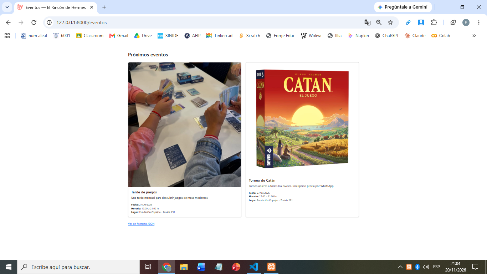

### Cómo ejecutarlo

**CRUD con MVC (XAMPP)**

1. Tener importados `clase6/schema.sql`, los datos de `clase6/consultas.sql` y `clase10/sql/01_tabla_usuarios.sql`.
2. Copiar `clase10/.env.example` a `clase10/.env` y completar las variables.
3. Iniciar Apache y MySQL, y entrar con un usuario con rol `admin` a `http://localhost/ERDH/clase10/admin/index.php`.

**Laravel (requiere PHP 8.2+ y Composer)**

```bash
cd clase10/laravel-eventos
composer install
cp .env.example .env
php artisan key:generate
# revisar en .env: DB_DATABASE=rincon_de_hermes, DB_USERNAME y DB_PASSWORD
php artisan serve
```

Abrir `http://127.0.0.1:8000/eventos` (HTML) y `http://127.0.0.1:8000/api/eventos` (JSON).
