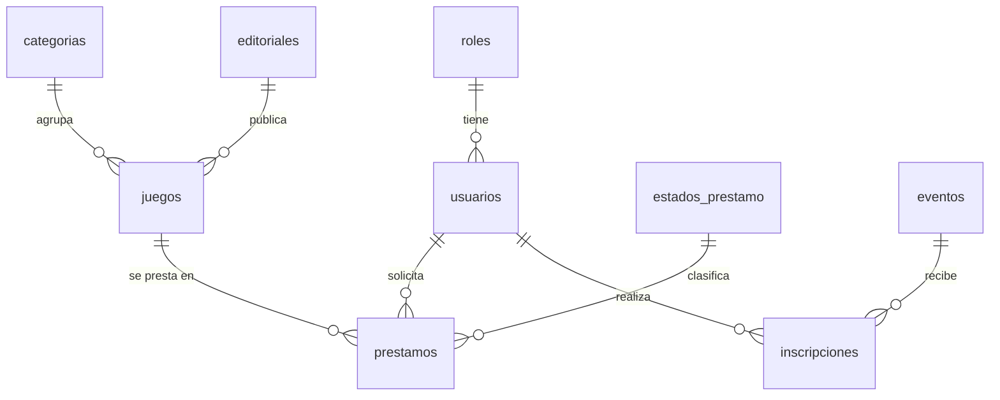

# Descripción
Aplicación web para el club y tienda de juegos de mesa El Rincón de Hermes, desarrollada a partir de los wireframes y el mockup diseñados en Figma en trabajos prácticos anteriores.

El proyecto fue refactorizado de páginas HTML independientes a una estructura basada en PHP, incorporando plantillas reutilizables mediante header.php, nav.php y footer.php, navegación dinámica y configuración mediante variables de entorno.

## Enlaces
Repositorio: https://github.com/Florare83/ERDH
Wireframes y Mockups en Figma: https://www.figma.com/design/hipG4LOssrktKAuL9P4VDI/ERDH?node-id=16-458&t=eVWlSxP531yBRfNM-1

## Tecnologías utilizadas
- HTML5 — estructura semántica de las vistas.
- CSS3 — estilos personalizados mediante estilos css.
- Bootstrap 5.3 — sistema de grillas, navegación y componentes.
- JavaScript — funcionalidades e interacción del sitio.
- PHP 8.x — refactorización de las páginas y generación de contenido dinámico.
- XAMPP — servidor local utilizado para ejecutar Apache y PHP.
- Prettier — formateo automático del código.
- Lighthouse (Chrome DevTools) — auditoría de accesibilidad.

## Refactorización a PHP
Durante la refactorización se reemplazaron las páginas HTML por archivos PHP.
Se implementó una estructura modular mediante plantillas reutilizables:
includes/
├── header.php
├── nav.php
└── footer.php
Las páginas principales reutilizan estas plantillas mediante require_once, evitando repetir el código del encabezado, menú de navegación y pie de página.
También se implementó navegación dinámica mediante la variable $pagina_actual, que permite determinar qué sección del menú debe mostrarse como activa.
Además, el título de cada página se establece mediante la variable $titulo_pagina.

## Variables de entorno
El proyecto utiliza un archivo .env para almacenar valores de configuración.
Las variables utilizadas son:
APP_NAME="El Rincón de Hermes"
APP_EMAIL="email@ejemplo.com"
APP_ENV=local
El archivo .env no se incluye en el repositorio y está excluido mediante .gitignore.
Para indicar las variables necesarias para ejecutar el proyecto se incluye el archivo:
.env.example
La configuración es cargada desde:
config/
└── env.php
La carpeta node_modules/ no se incluye en el repositorio porque sus dependencias pueden instalarse nuevamente mediante npm.

## Instalación y ejecución local
1. Clonar el repositorio
git clone https://github.com/Florare83/ERDH.git
2. Colocar el proyecto en XAMPP
Copiar o clonar el proyecto dentro de la carpeta:
C:\xampp\htdocs\
3. Crear archivo .env
Copiar .env.example y crear un archivo .env
Configurar las variables correspondientes:
APP_NAME="El Rincón de Hermes"
APP_EMAIL="email@ejemplo.com"
APP_ENV=local
4. Iniciar XAMPP
Abrir el panel de XAMPP e iniciar:
Apache
5. Abrir el proyecto
Ingresar desde el navegador a:
http://localhost/ERDH/clase5/index.php

## Servidor local ejecutándose

## Estructura Modular (SSI):
Utilización de las plantillas PHP reutilizables:
header.php
nav.php
footer.php

## Navegación dinámica
Las páginas utilizan un título dinámico mediante $titulo_pagina y determinan la sección activa del menú mediante $pagina_actual.

## Configuración de variables de entorno
El archivo .env.example contiene las variables necesarias para la configuración del proyecto.

## Resultado de la prueba de accesibilidad

## Estructura

## Clase 5 – Procesamiento de Formularios y Seguridad Web

### Formulario POST – Contacto (`contacto.php`)
Formulario con nombre, correo y mensaje. Valida en servidor que los campos
no estén vacíos y que el correo tenga formato válido. Sanitiza con
`trim()` y `htmlspecialchars()`. Ante errores conserva los datos ingresados.

### Formulario GET – Buscador (`buscar.php`)
Módulo de búsqueda que recibe el término por `$_GET['q']`, lo sanitiza,
valida que no esté vacío y muestra los resultados coincidentes.

### Seguridad
Todas las variables de `$_POST` y `$_GET` se sanitizan con la función
`limpiar()` (`includes/funciones.php`) para prevenir XSS.

### Capturas

**1. Contacto vacío: errores de validación**

**2. Correo inválido: error de formato y campos conservados**

**3. Envío correcto**

**4. XSS en contacto**

**5. Búsqueda por GET**

**6. Búsqueda vacía**

**7. XSS en el buscador**

## TP6 – Diseño y Creación del Esquema Relacional en MySQL

Diseño de la base de datos del proyecto **El Rincón de Hermes**, aplicando normalización (1FN, 2FN y 3FN), script de creación en MySQL y consultas CRUD de prueba.

### Archivos

Carpeta [`clase6/`](clase6/):

- [`NORMALIZACION.md`](tp6/NORMALIZACION.md): registro sin normalizar, proceso de 1FN, 2FN y 3FN, y listado de tablas con PK y FK.
- [`schema.sql`](tp6/schema.sql): creación de la base `rincon_de_hermes`, las tablas, las claves foráneas y los índices.
- [`consultas.sql`](tp6/consultas.sql): sentencias `INSERT`, `SELECT`, `UPDATE` y `DELETE` para probar la estructura con datos del proyecto.

### Tablas del esquema

| Tabla | Descripción |
|---|---|
| `roles` | Roles de usuario (admin, socio) |
| `usuarios` | Datos personales, email, contraseña y rol |
| `categorias` | Infantil, Familiar y Experto |
| `editoriales` | Devir, Maldon, Multiverso, etc. |
| `estados_prestamo` | Pendiente, En curso y Devuelto |
| `juegos` | Catálogo de juegos, a la venta y en préstamo |
| `prestamos` | Juegos prestados a cada socio |
| `eventos` | Cronograma del club |
| `inscripciones` | Relación N:M entre usuarios y eventos |
| `mensajes_contacto` | Mensajes enviados desde `contacto.php` |

### Diagrama de relaciones

### Decisiones de diseño

- Las páginas de tienda y de préstamo muestran los mismos juegos, por eso hay una sola tabla `juegos` con los campos `disponible_venta` y `disponible_prestamo`.
- Jugadores y duración se guardan en columnas numéricas (mínimo y máximo) para poder filtrar.
- Los precios usan `DECIMAL(10,2)` y las contraseñas se guardarán como hash con `password_hash()` de PHP.
- Todas las claves foráneas usan el motor InnoDB para garantizar la integridad referencial.
- Se crearon índices sobre la categoría y el título del juego (usados por las páginas de catálogo y por `buscar.php`), el estado de los préstamos y la fecha de los eventos.

### Cómo ejecutarlo en local (XAMPP)

1. Iniciar **Apache** y **MySQL** desde el panel de XAMPP.
2. Abrir `http://localhost/phpmyadmin`.
3. En la pestaña **Importar**, cargar `clase6/schema.sql` (crea la base y las tablas).
4. Seleccionar la base `rincon_de_hermes`, ir a **Importar** y cargar `clase6/consultas.sql`.

Para volver a ejecutar las pruebas desde cero, importar de nuevo `schema.sql` (borra y recrea las tablas) y después `consultas.sql`.

### Consultas de prueba (CRUD)

- **Create:** datos iniciales en roles, categorías, editoriales, estados, usuarios, juegos, eventos y préstamos.
- **Read:** `SELECT` con `WHERE` y `ORDER BY`, y `INNER JOIN` entre juegos, editoriales y categorías, y entre préstamos, usuarios, juegos y estados.
- **Update:** cambio de precio de un juego y cierre de un préstamo, ambos con `WHERE`.
- **Delete:** baja de un mensaje de prueba con `WHERE`.

Clase 7 – Persistencia y Conexión PHP-MySQL Segura (TP7)

Módulo de administración (CRUD) del catálogo de juegos de El Rincón de Hermes, conectado a MySQL mediante PDO e integrado al layout del sitio (Bootstrap + header.php, nav.php, footer.php).

La entidad gestionada es la tabla juegos del modelo diseñado en el TP6 (clase6/schema.sql), relacionada con editoriales y categorias.

Estructura del módulo
clase7/
├── config/
│   ├── env.php              # Carga de variables de entorno (.env)
│   └── conexion.php         # Conexión PDO con try-catch (PDOException)
├── includes/
│   ├── header.php           # Plantilla modular (SSI)
│   ├── nav.php
│   ├── footer.php
│   └── funciones.php        # limpiar() y e() (escape de salida)
├── admin/
│   ├── index.php            # Listado (Read)
│   ├── crear.php            # Formulario + inserción (Create)
│   ├── editar.php           # Formulario + actualización (Update)
│   ├── eliminar.php         # Eliminación (Delete)
│   ├── _form.php            # Formulario compartido por crear/editar
│   └── _funciones_juegos.php# Captura y validación de datos
├── css/  img/  js/
└── .env.example
Requisitos
XAMPP (Apache + MySQL) o Laragon
PHP 8.x
Base de datos rincon_de_hermes importada desde clase6/schema.sql
Instalación y ejecución local
Clonar o copiar el repositorio dentro de C:\xampp\htdocs\.
Iniciar Apache y MySQL desde el panel de XAMPP.
Abrir http://localhost/phpmyadmin, ir a Importar y cargar clase6/schema.sql.
Cargar los datos iniciales ejecutando en la pestaña SQL la sección 1) CREATE - Datos iniciales de clase6/consultas.sql.
Copiar clase7/.env.example como clase7/.env y completar las variables:
APP_NAME="El Rincón de Hermes"
APP_EMAIL="email@ejemplo.com"
APP_ENV=local
DB_HOST=localhost
DB_NAME=rincon_de_hermes
DB_USER=root
DB_PASS=
Abrir en el navegador:
http://localhost/ERDH/clase7/admin/index.php

El archivo .env no se incluye en el repositorio (está en .gitignore). Las credenciales de la base de datos se leen únicamente desde ese archivo.

Funcionalidades del CRUD
Operación	Archivo	Descripción
Read	admin/index.php	Lista los juegos con su editorial y categoría (INNER JOIN), ordenados del más reciente al más antiguo.
Create	admin/crear.php	Formulario con selects de editorial y categoría cargados desde la BD. Valida en el servidor y guarda con INSERT.
Update	admin/editar.php	Carga el registro por id, lo muestra en el formulario y lo actualiza con UPDATE ... WHERE id_juego = :id.
Delete	admin/eliminar.php	Elimina por id con DELETE ... WHERE id_juego = :id, previa confirmación en el navegador.

Después de cada operación se redirige al listado con un mensaje de estado (?status=created|updated|deleted|...) que se traduce a un texto fijo del servidor; nunca se imprime directamente el valor recibido por URL.

Validaciones del servidor
El título es obligatorio y no puede superar los 100 caracteres.
Editorial y categoría deben estar seleccionadas.
La cantidad máxima de jugadores no puede ser menor que la mínima.
La duración máxima no puede ser menor que la mínima.
El precio y el stock no pueden ser negativos.
Ante errores, el formulario conserva los datos ingresados y muestra la lista de problemas.
Seguridad

Conexión segura (config/conexion.php)

Instancia de PDO con ERRMODE_EXCEPTION, FETCH_ASSOC y EMULATE_PREPARES = false (preparación real en el servidor).
Bloque try-catch con PDOException. El detalle técnico del error solo se muestra si APP_ENV=local.
Credenciales almacenadas en .env, fuera del repositorio.

Consultas preparadas (Prepared Statements)

Todas las consultas (lectura, inserción, actualización y borrado) usan prepare() + execute() con parámetros nombrados (:titulo, :precio, :id, etc.).
Ningún dato recibido por $_POST o $_GET se concatena dentro de una sentencia SQL.

Ejemplo (crear.php):

php
$sql = "INSERT INTO juegos (titulo, id_editorial, ..., imagen)
        VALUES (:titulo, :id_editorial, ..., :imagen)";
$stmt = $pdo->prepare($sql);
$stmt->execute([':titulo' => $juego['titulo'], ...]);

Prevención de XSS

Todas las variables impresas en las vistas pasan por htmlspecialchars() mediante el helper e() (ENT_QUOTES, UTF-8).
Los datos se guardan "crudos" (solo trim()) y se escapan al momento de mostrarlos, para evitar el doble escapado en la base de datos.

Otras decisiones de seguridad

El borrado se realiza mediante POST (no por un enlace GET), para que no pueda dispararse por error o desde un enlace externo.
Los identificadores recibidos se validan con filter_input(..., FILTER_VALIDATE_INT).
Si se intenta eliminar un juego con préstamos asociados, la violación de clave foránea (SQLSTATE 23000) se captura y se informa al usuario con un mensaje claro, sin errores sin controlar.