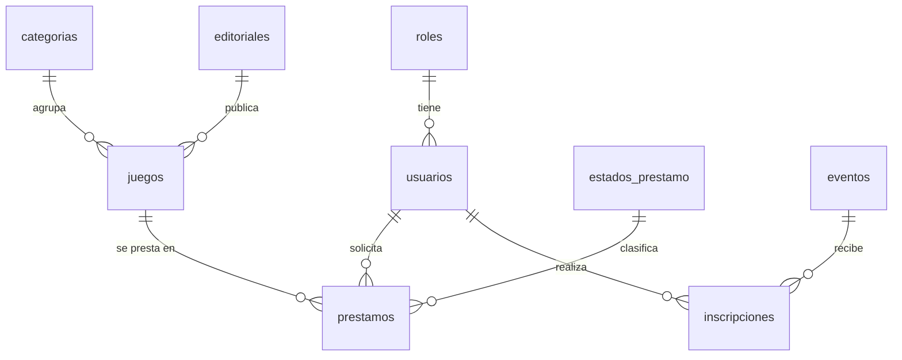

# TP6 – Normalización y esquema relacional: El Rincón de Hermes

Sistema web de un club y tienda de juegos de mesa. Muestra un catálogo de juegos (a la venta y en préstamo) clasificados en Infantil, Familiar y Experto, un cronograma de eventos y un formulario de contacto.

## 1. Entidad sin normalizar

Una "ficha de préstamo" tal como se podría anotar hoy en una planilla, con listas dentro de un mismo campo y datos repetidos:

| id_prestamo | socio | email | teléfonos | juegos_prestados | categorías | editoriales | estado | fecha_prestamo |
|---|---|---|---|---|---|---|---|---|
| 1 | Juan Pérez | juan@example.com | 3874000002, 3874111111 | Catan, Flamencos | Familiar, Infantil | Devir, Maldon | En curso | 2026-10-20 |
| 2 | Juan Pérez | juan@example.com | 3874000002, 3874111111 | Exit | Experto | Editorial | Devuelto | 2026-09-10 |

Problemas: `teléfonos`, `juegos_prestados`, `categorías` y `editoriales` guardan varios valores en una celda; los datos de Juan se repiten en cada fila (si cambia su email hay que corregirlo en muchos lugares).

## 2. Proceso de normalización

### 1FN – Valores atómicos, sin grupos repetitivos

Se separa cada valor en su propia fila. Clave primaria compuesta: **(id_prestamo, id_juego)**. Los teléfonos pasan a un único campo `telefono` en el usuario (un teléfono por socio, suficiente para el proyecto).

| id_prestamo | id_juego | socio | email | telefono | titulo | categoria | editorial | precio | estado | fecha_prestamo |
|---|---|---|---|---|---|---|---|---|---|---|
| 1 | 5 | Juan Pérez | juan@example.com | 3874000002 | Catan | Familiar | Devir | 67888 | En curso | 2026-10-20 |
| 1 | 2 | Juan Pérez | juan@example.com | 3874000002 | Flamencos | Infantil | Maldon | 24000 | En curso | 2026-10-20 |
| 2 | 8 | Juan Pérez | juan@example.com | 3874000002 | Exit | Experto | Editorial | 45000 | Devuelto | 2026-09-10 |

### 2FN – Sin dependencias parciales de la clave

Con la clave compuesta (id_prestamo, id_juego) hay columnas que dependen de solo una parte:

- Dependen solo de `id_prestamo`: socio, email, telefono, estado, fecha_prestamo.
- Dependen solo de `id_juego`: titulo, categoria, editorial, precio.

Se descompone en tres tablas: **usuarios** (datos del socio), **juegos** (datos del juego) y **prestamos**. En este proyecto cada fila de `prestamos` representa un juego prestado a un usuario en una fecha (la relación N:M usuarios–juegos queda resuelta por la propia tabla `prestamos`, que además guarda fechas y estado, por eso su PK es un `id_prestamo` propio).

### 3FN – Sin dependencias transitivas

Atributos no clave que dependen de otro atributo no clave:

- En `juegos`: `categoria` y `editorial` se repiten como texto ("Devir" aparece en varios juegos). Se extraen a **categorias** y **editoriales**, y `juegos` guarda solo `id_categoria` e `id_editorial`.
- En `prestamos`: `estado` como texto se extrae a **estados_prestamo**.
- En `usuarios`: el rol (admin/socio) se extrae a **roles**.

Además, el cronograma de `club.php` genera **eventos**, y como un socio puede inscribirse a muchos eventos y un evento tiene muchos inscriptos (N:M), se crea la tabla de relación **inscripciones**. El formulario de `contacto.php` se guarda en **mensajes_contacto**.

## 3. Listado de tablas resultante

| Tabla | PK | FK |
|---|---|---|
| roles | id_rol | – |
| categorias | id_categoria | – |
| editoriales | id_editorial | – |
| estados_prestamo | id_estado | – |
| usuarios | id_usuario | id_rol → roles |
| juegos | id_juego | id_editorial → editoriales, id_categoria → categorias |
| prestamos | id_prestamo | id_usuario → usuarios, id_juego → juegos, id_estado → estados_prestamo |
| eventos | id_evento | – |
| inscripciones | (id_usuario, id_evento) | id_usuario → usuarios, id_evento → eventos |
| mensajes_contacto | id_mensaje | – |

### Diagrama (Mermaid)

## 4. Decisiones de diseño

- Las páginas `tienda-*.php` y `prestamo-*.php` muestran los mismos juegos y precios, por eso hay una sola tabla `juegos` con las banderas `disponible_venta` y `disponible_prestamo`, en lugar de dos catálogos duplicados.
- Jugadores y duración, que hoy se muestran como "2-6" y "60-120 min", se guardan como columnas numéricas (`jugadores_min`, `jugadores_max`, `duracion_min`, `duracion_max`) para poder filtrar.
- Los precios usan `DECIMAL(10,2)`; la contraseña se guardará con `password_hash()` desde PHP.
